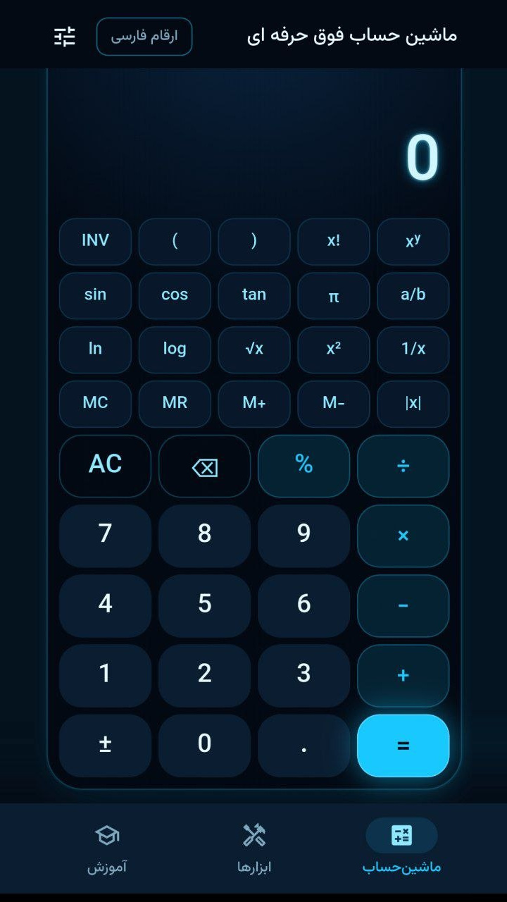
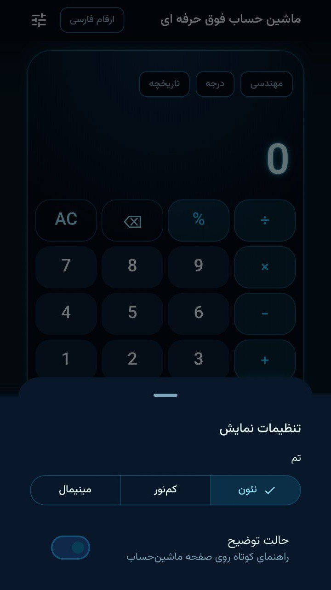
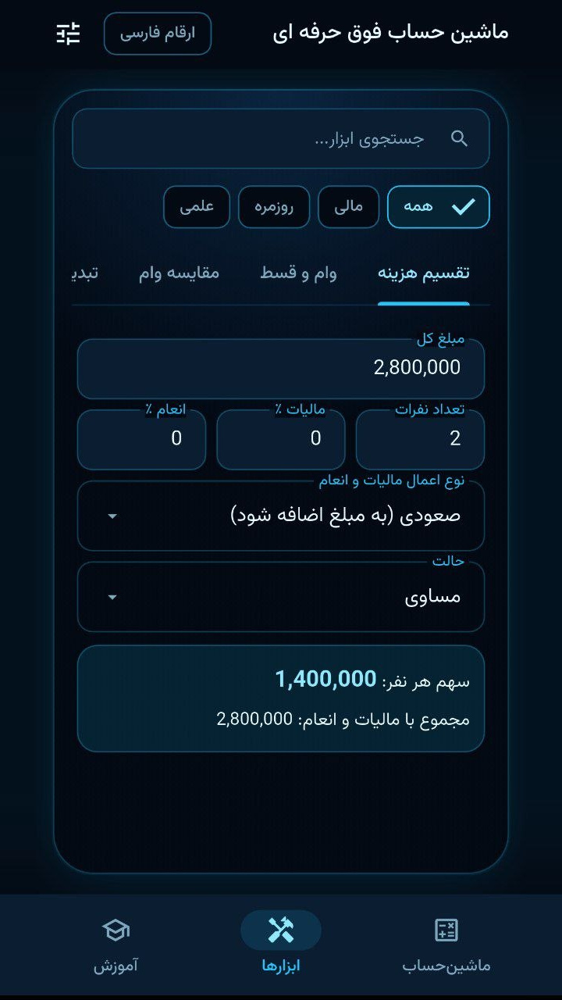
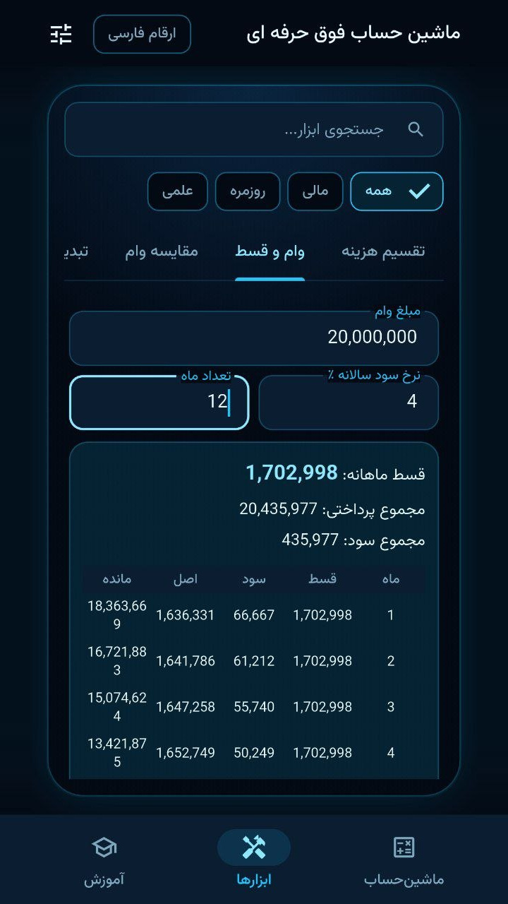
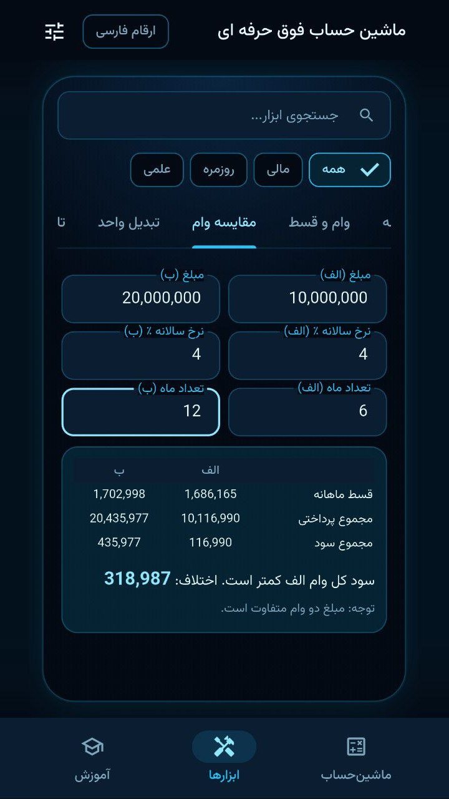
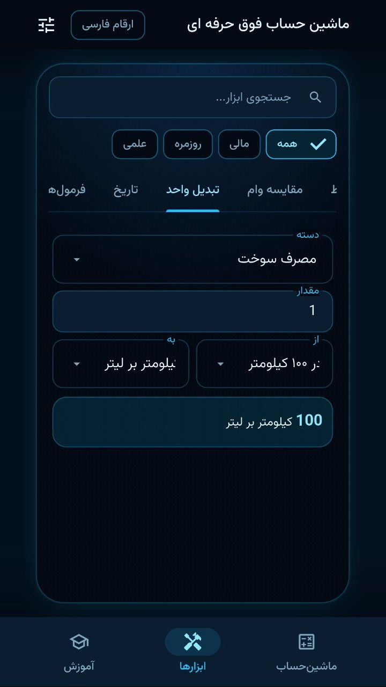
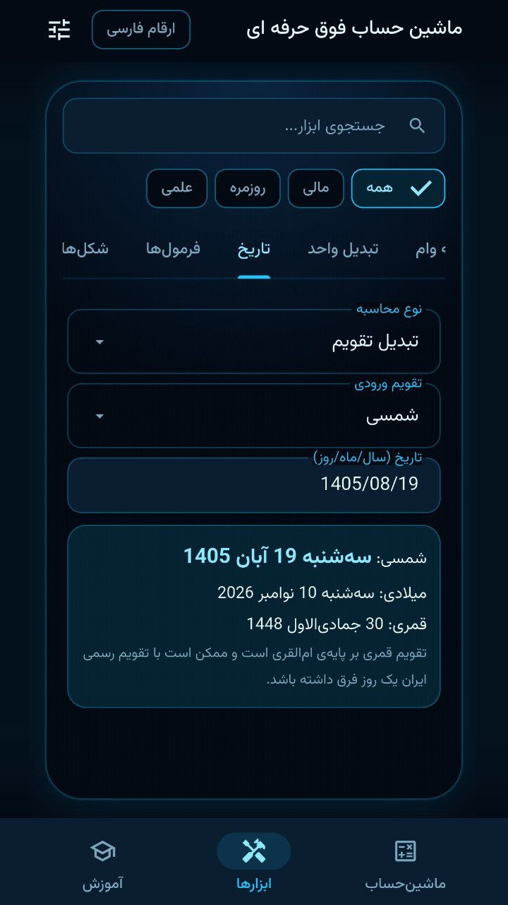
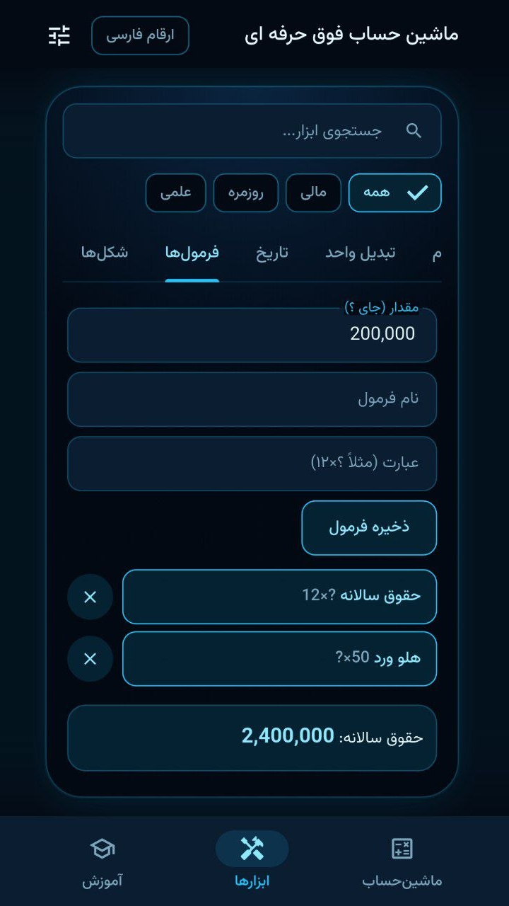
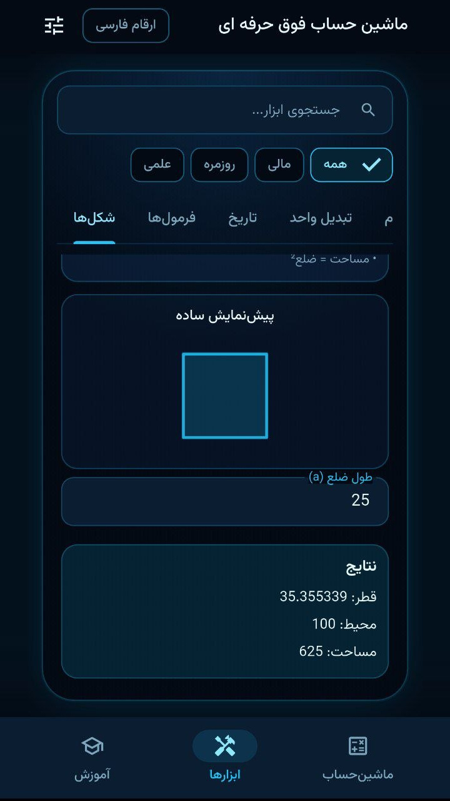
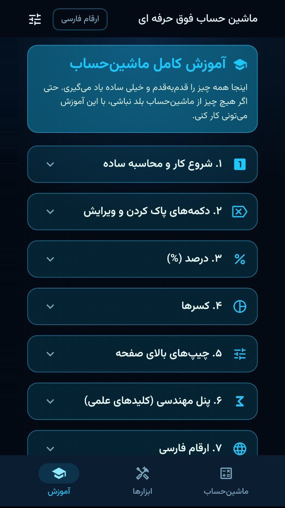

# ⚡ Neon Calc
### ماشین‌حساب مهندسی و مجموعه ابزارهای کاربردی

یک ماشین‌حساب فارسی با طراحی نئونی، امکانات علمی و مجموعه‌ای از ابزارهای روزمره و مالی؛
ساخته‌شده با Flutter و با تمرکز بر تجربه کاربری ساده، سریع و واکنش‌گرا.

---

## 📱 معرفی برنامه

**Neon Calc** فقط یک ماشین‌حساب ساده نیست. این برنامه علاوه بر محاسبات روزمره، ابزارهای علمی، مالی و کاربردی را در یک محیط یکپارچه در اختیار شما قرار می‌دهد.

رابط کاربری فارسی، پشتیبانی از ارقام فارسی و انگلیسی، حالت‌های مختلف نمایش و چیدمان سازگار با حالت عمودی و افقی گوشی، استفاده از برنامه را راحت‌تر می‌کند.

## ✨ امکانات

### 🧮 ماشین‌حساب معمولی و مهندسی
- انجام محاسبات پایه: جمع، تفریق، ضرب و تقسیم
- پشتیبانی از محاسبات علمی و توابع ریاضی
- توابع مثلثاتی و معکوس آن‌ها: `sin`، `cos`، `tan`، `asin`، `acos` و `atan`
- محاسبه لگاریتم طبیعی و ده‌دهی: `ln` و `log`
- محاسبه توان، فاکتوریل، درصد و ریشه دوم و سوم
- پشتیبانی از ثابت‌های ریاضی π و e
- انتخاب حالت زاویه بر حسب درجه یا رادیان
- پنل کلیدهای مهندسی و ورودی کسر
- مدیریت حافظه محاسباتی و تاریخچه

### 🧰 ابزارهای کاربردی
برنامه شامل هفت ابزار مستقل است که از بخش ابزارها قابل دسترسی هستند:

| ابزار | کاربرد |
|---|---|
| تقسیم هزینه | محاسبه سهم هر نفر از هزینه‌های مشترک |
| وام و قسط | محاسبه اقساط وام |
| مقایسه وام | مقایسه شرایط وام‌ها |
| تبدیل واحد | تبدیل بین واحدهای مختلف |
| تاریخ | ابزارهای مرتبط با تاریخ |
| فرمول‌ها | دسترسی به فرمول‌های کاربردی |
| شکل‌ها | محاسبات مربوط به شکل‌های هندسی |

### 🎨 تجربه کاربری و شخصی‌سازی
- طراحی تیره با جلوه‌های نئونی
- سه سبک نمایش: **نئون، کم‌نور و مینیمال**
- امکان روشن یا خاموش کردن نمایش ارقام فارسی
- حالت توضیح برای نمایش راهنمای کوتاه در ماشین‌حساب
- رابط کاربری فارسی
- پشتیبانی از حالت عمودی و افقی
- چیدمان واکنش‌گرا برای اندازه‌های مختلف صفحه
- حفظ وضعیت صفحات هنگام جابه‌جایی بین بخش‌ها

---

## 🖼️ تصاویر برنامه

<table>
  <tr>
    <td align="center"> نمای برنامه ۱</td>
    <td align="center"> نمای برنامه ۲</td>
  </tr>
  <tr>
    <td align="center"> نمای برنامه ۳</td>
    <td align="center"> نمای برنامه ۴</td>
  </tr>
  <tr>
    <td align="center"> نمای برنامه ۵</td>
    <td align="center"> نمای برنامه ۶</td>
  </tr>
  <tr>
    <td align="center"> نمای برنامه ۷</td>
    <td align="center"> نمای برنامه ۸</td>
  </tr>
  <tr>
    <td align="center"> نمای برنامه ۹</td>
    <td align="center"> نمای برنامه ۱۰</td>
  </tr>
</table>

---

## ⬇️ دانلود برنامه

برای دریافت نسخه اندروید، از لینک رسمی کافه‌بازار استفاده کنید:

### [دانلود Neon Calc از کافه‌بازار](https://cafebazaar.ir/app/com.example.neon_calc)

---

## 🛠️ فناوری‌های استفاده‌شده

- **Flutter** — توسعه رابط کاربری چندسکویی
- **Dart** — زبان برنامه‌نویسی
- **Provider** — مدیریت وضعیت و تنظیمات برنامه
- **Material 3** — ساختار و اجزای رابط کاربری
- **Flutter Localizations** — پشتیبانی از بومی‌سازی و رابط فارسی

---

---

## ℹ️ درباره این مخزن

این مخزن صرفاً برای معرفی ظاهری اپلیکیشن **Neon Calc** و نمایش تصاویر محیط برنامه ایجاد شده است. سورس‌کد اصلی پروژه در این مخزن منتشر نشده و این صفحه جنبه نمایشی و معرفی دارد.

---

## 🧭 بخش‌های اصلی برنامه

- **ماشین‌حساب:** محاسبات عادی و علمی
- **ابزارها:** ابزارهای مالی، روزمره و علمی
- **آموزش:** راهنمای قدم‌به‌قدم استفاده از ماشین‌حساب

---

## 🤝 مشارکت

پیشنهادها، گزارش خطاها و مشارکت در توسعه پروژه ارزشمند هستند.
اگر ایده‌ای برای بهتر شدن Neon Calc دارید، می‌توانید یک Issue ثبت کنید یا Pull Request ارسال کنید.

---

**ساخته‌شده با ❤️ و Flutter**

اگر این پروژه برایتان مفید بود، خوشحال می‌شوم با ⭐ دادن به مخزن از آن حمایت کنید.

